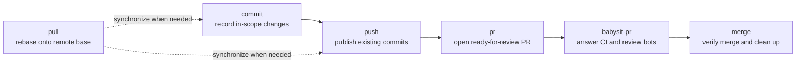

# Skills

[](https://skills.sh/toy-crane/skills)

A composable, model-agnostic set of skills for product definition, shaping,
prototyping, implementation, runtime verification, human
review, project knowledge, verified follow-up resolution, test-first
development, project skill updates with cross-client custom-agent
synchronization, and safe Git delivery. Install selected skills or the complete plugin.

## Install

Choose copy-in installation or the managed plugin.

### skills.sh (copy into your project)

Copies selected skill folders into your project for local editing.

```bash
npx skills@latest add toy-crane/skills
```

Choose the skills and coding agents to install.

If an existing copy was installed before the source catalog moved into the
`git`, `workflow`, and `expo` groups, run the add command once more instead of
relying on `skills update`. The CLI tracks the exact upstream skill path, while
the reinstallation keeps the same skill names and refreshes that path.
`update-project-skills` reports such entries instead of reinstalling them.

The product-context workflow replaces `discover-opportunity` with
`define-product` and renames `compact-decisions` to
`maintain-project-context`. A copy-in installation does not receive aliases for
the retired names; remove those old copied folders after installing the
replacements.

### Project update (installed skills + companion agents)

Install `update-project-skills` once, then invoke it whenever a project should
follow the latest published skills:

```bash
npx -y skills@latest add toy-crane/skills \
  --skill update-project-skills \
  --agent codex claude-code \
  -y
```

Use `/update-project-skills` in Claude Code or `$update-project-skills` in
Codex. It updates every skill recorded in `skills-lock.json` through
`skills update`, whatever its source, then reconciles the Toycrane set:
installs newly published skills that apply to the project's stack, retires
unpublished managed skills, and materializes any companion custom agents into
both `.claude/agents/` and `.codex/agents/`. Third-party skills are refreshed in
place only, and the locks preserve project-owned skills and agents unless the
user explicitly approves adopting a colliding name.

This is the cross-client installation path for companion agents. A skill folder
can carry their source payload, but neither client discovers that nested payload
as a native custom agent on its own.

### Claude Code plugin (managed bundle)

Installs the complete set as a read-only bundle. Updates arrive with new plugin
versions.

Inside Claude Code:

```
/plugin marketplace add toy-crane/skills
/plugin install toycrane-skills@toycrane
```

Or from your shell:

```bash
claude plugin marketplace add toy-crane/skills
claude plugin install toycrane-skills@toycrane
```

The plugin installs the managed skill bundle for Claude Code. Run the
project-local sync workflow above when the same project also needs companion
agents in Claude Code and Codex.

## The pipeline

Eight skills cover product definition through implementation.

```mermaid
flowchart LR
    DP["define-product<br/>(rough direction known)"] --> READY{"whole direction clear<br/>without guessing?"}
    READY -- "no" --> ASK["ask about real use<br/>(no guessed answers)"]
    ASK --> READY
    READY -- "yes" --> REQUEST{"writing already<br/>requested?"}
    REQUEST -- "yes" --> PRODUCT[/PRODUCT.md/]
    REQUEST -- "no" --> DRAFT["show the whole direction"]
    DRAFT --> CONFIRM{"confirmed?"}
    CONFIRM -- "not yet" --> ASK
    CONFIRM -- "yes" --> PRODUCT
    PRODUCT --> LOOP{"core loop already<br/>runs in the repo?"}
    LOOP -- "no" --> CAND["report names one candidate:<br/>thinnest pass through the core loop"]
    CAND -. "user may hand it over" .-> SI
    PRODUCT -. "read when present" .-> SI["shape-idea<br/>(one work unit)"]
    SI --> BP["build-prototype<br/>(judge it by using it)"]
    SI --> SPEC[/"spec folders<br/>(one per outcome that can land alone)"/]
    BP --> SPEC
    SPEC --> IM["implement<br/>(one folder per run)"]
    IM --> ONE["build one outcome"]
    ONE --> CHECK["check real behavior"]
    CHECK --> MATCH{"still matches<br/>the spec?"}
    MATCH -- "technical facts changed" --> UPDATE["correct the technical approach"]
    UPDATE --> ONE
    MATCH -- "work-unit promise changed" --> SI
    MATCH -- "app premise changed" --> DP
    MATCH -- "yes" --> MORE{"more outcomes?"}
    MORE -- "yes" --> ONE
    MORE -- "no" --> FULL["full deterministic checks"]
    FULL --> REVIEW["complete one code review"]
    REVIEW -- "result for intended diff" --> TRIAGE{"breaks a criterion or<br/>reproduces as a defect?"}
    REVIEW -- "no completed result" --> PENDING["review pending<br/>share verified result + blocker"]
    PENDING -- "failure resolved or authority granted" --> REVIEW
    PENDING -- "explicit user waiver" --> FINAL
    TRIAGE -- "yes" --> FIX["repair, recheck<br/>(no second review)"]
    FIX --> FINAL["final changed/core loop<br/>on every claimed platform"]
    TRIAGE -- "no" --> REC["record: follow-up,<br/>note, or user decision"]
    REC --> FINAL
    FINAL -- "in-scope defect" --> FIX
    FINAL -- "blocked" --> BLOCKED["runtime pending<br/>share evidence + prerequisite"]
    BLOCKED -- "prerequisite restored" --> FINAL
    FINAL -- "passes" --> DONE["verified and runnable<br/>reviewed or explicitly waived"]
    IM -. "hands criteria to test" .-> TDD[tdd]
    IM -. "hands LLM-output criteria" .-> EV[llm-evals]
    IM -. "proves affected surfaces" .-> RV["matching runtime skill<br/>or strongest usable path"]
    IM -. "open workaround or<br/>out-of-scope defect" .-> FU["follow-up"]
```



Invoke `define-product` when starting a from-scratch app whose rough direction
or problem is already known. It starts from a concrete use scene and draws out
the user's product meaning instead of filling gaps from the initial solution
idea. After the complete direction is confirmed, it creates or revises root
`PRODUCT.md` with the users and situations, problem and alternatives, promised
change, core loop, capabilities and boundaries, experience principles, success
signals, assumptions, and unknowns. Blank-page idea discovery is outside this
workflow.

When the repository does not yet run the core loop from start to end, the
completion report also names one next work-unit candidate: the thinnest outcome
that runs the core loop once, with a request to hand to `shape-idea`. It is an
AI proposal the user may correct or ignore. It never lands in `PRODUCT.md`,
never starts shaping, and comes with no feature list or order. Once the loop
runs, choosing each later work unit stays with the user.

Start with `shape-idea` when one concrete problem and broad work-unit direction
are already known. It reads `PRODUCT.md` when present but remains independently
usable when the file is absent, and it neither creates nor edits app-level
product context.

`shape-idea` records one stable product contract in
`docs/specs/<slug>/spec.md`: user-visible outcomes, scope, observable acceptance
criteria, settled constraints and rationale, assumptions, off-limits areas and
reasons, deferrals, and risks. `build-prototype` can start from the current
conversation alone; when a whole interface is approved and consequential
non-visual behavior is settled or explicitly deferred, it creates or updates
that same contract and preserves `prototype.html` beside it.

One coherent workflow stays one spec. When a shaped change has several
outcomes, `shape-idea` proposes the whole division at once and writes one spec
folder per outcome only after you approve it. A folder holds an outcome that
could land on the default branch and stay there even if the rest never
arrives; outcomes that pass that test still share a folder unless one is
wanted earlier, a wait outside the repository separates them, a later outcome
builds on a foundation that needs its own review, or they are unrelated. A
folder that must wait for another carries a `Blocked by: docs/specs/<other>/`
line, and you, a tracker, or a runner picks which folder runs next.

Then pass one spec folder to `implement`. Before each outcome, it reloads the
current spec, code, Git state, and verification evidence, then plans only that
outcome in detail. After focused verification, it checks the observed result
against the product contract. It may correct technical assumptions when the
approved product behavior stays the same. If an approved outcome, observable
acceptance criterion, scope, or other product constraint must change, it stops
and returns that exact decision to shaping. An outcome is reopened if later
evidence shows its criteria no longer pass. Each folder ends with its own
review, so a folder blocked by another starts only after that review.

After every outcome passes that check, the current harness's automated
code-review process reads the integrated result once against the selected spec
and acceptance criteria. `implement` picks the depth that change warrants, and
its findings are triaged rather than looped: `implement` repairs only what
breaks an approved acceptance criterion or reproduces as a defect on an
ordinary path, then records the rest as follow-ups, disposed trade-offs, or
decisions the user owns. Completion requires a finished review of the intended
diff or an explicit user waiver; it does not require zero findings. Failed,
partial, silent, or mistargeted attempts do not count as the one pass.
`implement` recovers execution errors within the authorized scope and retries.
It accurately identifies any model service and source context, reuses existing
user authorization without asking again, and requests only missing authority.
An explicit policy denial requires a permitted safer path or the needed
authority before retrying. If review cannot finish, overall completion stays
pending while verified outcomes, the blocker, and the next action are provided.
When the repository exposes the result through a
user-reviewable local server, `implement` verifies the changed surface and
shares an address while leaving that server available until the user finishes
review or later delivery cleanup. `implement` maps every acceptance criterion
to automated tests, evals, runtime evidence, or a combination, hands the
criteria to prove by tests to `tdd`, which selects the public seams, and hands
criteria about LLM output that varies run to run to `llm-evals`. For an affected product
surface, it
uses an available matching runtime-verification skill. When none is available,
it autonomously investigates the repository and current environment and builds
the strongest usable runtime path instead of asking the user to approve the
method. After focused checks and reconciliation, it runs the complete
deterministic checks, then the whole-diff review and any must-fix repairs with
affected verification. It finally verifies the changed flow and the
`PRODUCT.md` core loop on every claimed platform, including when review is
explicitly waived; missing core-loop coverage is reported rather than invented.
An in-scope defect found at that final gate returns to repair, affected checks,
and final verification of the repaired revision without a second review.
Current-scope gaps stay in implementation. A workaround with an open root cause
or an evidenced out-of-scope defect becomes a durable follow-up.

Pass the folder itself, not the `spec.md` file inside it.

Claude Code:

```text
/implement docs/specs/checkout/
```

Codex:

```text
$implement docs/specs/checkout/
```

The handoff lives at one stable path:

```text
docs/specs/checkout/
├── spec.md
└── prototype.html      # optional
```

Invoke the same folder again after an interruption. `implement` reconstructs
progress from the folder, Git, the current diff, and verification results; a
new session or a closing-message handoff is not required for correctness.

- **[define-product](./skills/workflow/define-product/SKILL.md)**: Draw out the
  product meaning behind a rough app direction, confirm it with the user, and
  preserve it in one current root `PRODUCT.md`. Keep app-level users, problem,
  promise, core loop, boundaries, experience principles, success signals,
  assumptions, and unknowns available across later work units without
  absorbing technical or feature-level detail.
- **[shape-idea](./skills/workflow/shape-idea/SKILL.md)**: Clarify a chosen problem and
  direction through correctable drafts, project evidence, and rendered UI
  variants. Maintain project terms and write the stable product contract that
  implementation must preserve. Divide a change with several outcomes into
  linked spec folders after you approve the division.
- **[build-prototype](./skills/workflow/build-prototype/SKILL.md)**: Build every screen in
  one dummy-data HTML file using the project's design system, or the shell's
  minimal style when none exists. Review the rendered screens and preserve the
  approved prototype beside the same product contract used by shaping.
- **[babysit-specs](./skills/workflow/babysit-specs/SKILL.md)**: Bring queued spec
  folders back in line with what shipped since their last commit. Fix the
  staleness that preserves the approved meaning as an overridable assumption,
  ask one question about each point that would change it, and hand folders
  that need re-dividing, drifted prototypes, and retirement candidates to
  their owners without editing product source.
- **[implement](./skills/workflow/implement/SKILL.md)**: Implement one approved spec
  folder per run, one outcome at a time. Reload repository evidence before each
  outcome, reconcile verified behavior with the product contract, reopen
  invalidated work, and return to shaping when a product decision must change.
  Then finish with full verification and one completed, triaged automated
  review, unless explicitly waived by the user. Recover review execution
  failures and reuse granted authority; blocked review leaves completion pending
  while the verified result and runnable product address remain available.
- **[tdd](./skills/workflow/tdd/SKILL.md)**: Write each new behavior's test
  before the behavior and see it fail on an assertion, with several tests
  allowed before one implementation. Acceptance criteria set the floor of what
  gets tested, bug fixes start from a reproduction, and failing tests are never
  weakened to reach green. Includes rules for stable seams and behavioral tests.
  Adapted from
  [mattpocock/skills](https://github.com/mattpocock/skills) (MIT).
- **[llm-evals](./skills/workflow/llm-evals/SKILL.md)**: Prove behavior whose
  LLM output varies run to run, such as a prompt, a classifier, an agent, or a
  skill's instructions, with an eval instead of a mocked test. Ask whether to
  reach the model through an API key or a Claude Code or Codex subscription,
  build an approved case set, runner, and grader, and stop once for approval
  with the noise floor and cost. Measure the baseline as the red, then climb
  one change per round until the held-out score reaches the spec's target.
  Cases and grader are never weakened to pass. The eval discipline follows
  claude-api's `build-eval` and `hillclimb` guides
  ([anthropics/skills](https://github.com/anthropics/skills), Apache-2.0).
- **[audit-evals](./skills/workflow/audit-evals/SKILL.md)**: Read a regression
  suite's committed cell history and report cells whose most recent 10 trials
  all passed, checks with identical recent histories, cells that flip after
  graduating, and cells that always fail. A bundled script does every count,
  so the same history always gives the same report. It proposes demoting the
  cells that recently always passed, by whole check or case with the runs and
  judge calls saved and each cell's total failures shown, to the tier that
  runs only when the model changes, and applies only the demotions the user
  approves. Nothing is deleted.

## Git delivery

Six skills cover the repository handoff from a local change to a merged base
branch, and a seventh clears the branches and worktrees that pile up afterward.
Invoke them directly with `/commit`, `/pull`, `/push`, `/pr`, `/babysit-pr`,
`/merge`, or `/clean-branches` in Claude Code and `$commit`, `$pull`, `$push`,
`$pr`, `$babysit-pr`, `$merge`, or `$clean-branches` in Codex.

When Codex exposes the managed plugin namespace, or a user-level skill with the
same short name is also installed, use `$toycrane-skills:commit`,
`$toycrane-skills:pull`, `$toycrane-skills:push`, `$toycrane-skills:pr`,
`$toycrane-skills:babysit-pr`, `$toycrane-skills:merge`, or
`$toycrane-skills:clean-branches` to select this
bundle unambiguously.



Each skill owns its whole advertised outcome. A skill that invokes another one
by name requires it: `merge` requires `pull`, `pr`, `babysit-pr`, and
`clean-branches`, and
stops before any work with the install command when one is missing. `push`
deliberately leaves dirty changes local. `pr` may perform the necessary
commit, synchronization, and publication, but stops before merge. `merge`
continues through verified remote merge and hands the merged branch to
`clean-branches`, which releases its worktree's resources through the
project's declared cleanup commands and removes it.

- **[commit](./skills/git/commit/SKILL.md)**: Record only the current request's
  changes as logical Conventional Commits while preserving unrelated work.
- **[pull](./skills/git/pull/SKILL.md)**: Rebase the current checkout onto the fetched
  requested base, or remote default, without treating a dirty tree as permission
  to modify local work.
- **[push](./skills/git/push/SKILL.md)**: Publish existing commits on a named branch,
  reconciling remote state and using lease protection for intentional rewrites.
- **[pr](./skills/git/pr/SKILL.md)**: Turn the current change into a ready-for-review
  GitHub pull request with a proportionate behavior explanation, verification
  evidence, and attached before-and-after screen comparisons when applicable;
  return its URL without merging it. With an issue tracker configured, first
  create the issue for each carried spec folder that has no `Issue:` line and
  commit that line.
- **[babysit-pr](./skills/git/babysit-pr/SKILL.md)**: Watch one open pull
  request through CI and review bots until it is ready to merge or needs a
  person. Fix bot findings confirmed against the source, decline the rest with
  evidence, answer and resolve each thread with an agent-authored note, rerun
  infrastructure flakes, and wake only on checks, reviews, comments, pushes,
  and conflicts. Never merges.
- **[merge](./skills/git/merge/SKILL.md)**: Carry a change through verified pull
  request merge, synchronizing through `pull`, creating or updating the PR
  through `pr`, and bringing it to ready through `babysit-pr`, choose squash or rebase by commit meaning, then hand the
  merged branch to `clean-branches` for cleanup. When a delivered spec asks
  for a post-release check and a tracker is configured, open one check issue
  due after the spec's period.
- **[clean-branches](./skills/git/clean-branches/SKILL.md)**: Sweep a
  repository's finished local work in one pass. Remove worktrees and local
  branches whose pull request merged or closed, detached worktrees the base
  already contains, and left-over folders that lost their Git registration;
  report open, uncommitted, session-attached, and Codex-managed ones with the
  reason they stayed. Also cleans the one branch `merge` hands over.

A project that gives each worktree its own servers, devices, or databases
declares how to release them in `AGENTS.md` or `CLAUDE.md`. `clean-branches`
runs the commands in order inside a worktree before removing it. Without the
section it stops no process, and it leaves a worktree that another session or
terminal still uses.

````md
## Worktree cleanup

Release this worktree's development resources. Agents run these from the worktree root.

```sh
bun run dev:remove
bun run db:remove
```
````

## Supporting workflows

Eleven additional skills can run independently. They handle stack setup, issue
tracker coordination for parallel spec work, Expo runtime verification,
pre-delivery both-platform checks, cross-client skill and agent
synchronization, incremental project knowledge, verified follow-up resolution,
visual explanation, final human judgment, periodic context maintenance, and
periodic review of session logs for work to make deterministic.
`implement` also uses a matching runtime-verification skill when one is
available for an affected product surface.

- **[add-stack-context](./skills/workflow/add-stack-context/SKILL.md)**: Audit the
  technologies that define a project's stack, discover vendor-controlled skills,
  keep changing official guidance live, and surface community skills for
  approval. Runs during agent setup, after stack changes, or on entering an
  unaudited project.
- **[setup-issue-tracker](./skills/workflow/setup-issue-tracker/SKILL.md)**: Record
  once per repository which issue tracker coordinates spec folders and, when
  requested, general-issue triage. Each spec folder names its one issue with an
  `Issue:` line: the PR that first carries the folder creates the issue, and a
  spec that starts from an existing issue records that one. Every lookup uses
  the recorded ID. `implement` claims the issue, and context maintenance repairs
  drift. The convention also records due dates, how `merge` opens a
  post-release check issue, and an optional notification method. Without the
  convention every skill behaves as before.
- **[triage-issues](./skills/workflow/triage-issues/SKILL.md)**: On a schedule or
  by hand, handle one named issue or up to three issues no earlier run
  triaged, including Backlog, each once when it comes due: on arrival, or on
  its due date. Run due post-release checks and leave their measured values
  for a person's decision. Return one report of what needs a person, with an
  optional summary of what is waiting, and copy it through the project's
  notification method when one is configured.
  Investigate and raise one verified implementation or spec PR when ready, or
  ask for only the missing information or product decision with evidence.
  Preserve the original issue throughout and prevent competing runs from
  handling it together through an atomic remote claim.
- **[expo-dev-loop](./skills/expo/expo-dev-loop/SKILL.md)**: Verify Expo and React
  Native changes in a running app with `agent-device`, first proving target
  readiness and the scenario's required state, then selecting Metro reload or
  native rebuild and completing only with device evidence.
- **[expo-smoke-test](./skills/expo/expo-smoke-test/SKILL.md)**: Before delivery,
  prepare a known-app, fresh-device, or preserved-prior state as the scenario
  requires, then drive the current change and the `PRODUCT.md` core loop on iOS
  and Android development builds through one isolated `expo-smoke-runner` per
  platform.
- **[update-project-skills](./skills/workflow/update-project-skills/SKILL.md)**:
  Update every skill installed in the project to its latest published version
  with `skills.sh`, reconcile the Toycrane set, and install, refresh, or retire
  its project-local companion agents for both Claude Code and Codex without
  taking ownership of unrelated artifacts.
- **[project-knowledge](./skills/workflow/project-knowledge/SKILL.md)**: Maintain project
  terms and settled decisions that future work should reuse whenever they are
  taking shape, including while a plan weighs alternatives. Keeps root
  `DESIGN.md`, the entry point for design work, mapped to the contracts that
  own each on-screen element. Does not run for lookup, routine implementation
  details, or execution of settled decisions.
- **[resolve-follow-ups](./skills/workflow/resolve-follow-ups/SKILL.md)**: Sweep
  evidence-backed `docs/follow-ups/` items in bounded batches, reproduce each
  symptom before editing, and publish verified fixes as independent
  worktree-isolated pull requests without automatic merge.
- **[explain-visually](./skills/workflow/explain-visually/SKILL.md)**: Render explanations
  with the best available tool. Use one sentence instead when one sentence fully
  answers the question.
- **[maintain-project-context](./skills/workflow/maintain-project-context/SKILL.md)**:
  Periodically reconcile `PRODUCT.md`, the glossary, decision contracts, shipped
  specs, agent instructions, and any configured spec issues after work
  accumulates. Apply only meaning that is already settled, refresh each spec
  issue found by its `Issue:` line from the remote default branch, and leave
  ambiguous conflicts for
  explicit clarification.
- **[review-sessions](./skills/workflow/review-sessions/SKILL.md)**: Mine this
  machine's recent Claude Code and Codex session logs for work agents redo by
  chance every session. A bundled script counts every session; the model reads
  only the event windows and five strictly sampled sessions it selects. The
  result is one offline HTML report of candidates with evidence, a proposed
  deterministic owner and form, and a re-measurement check by date or by the
  skill version each session loaded. It changes nothing; fixes stay with people
  and other skills.

## Output styles

- **[natural-korean](./output-styles/natural-korean.md)**: A Claude Code
  response style for natural, spoken-register Korean instead of
  translated-sounding Korean. Ships with the Claude Code plugin only —
  skills.sh copies skill folders, not output styles. Select it with
  `/output-style` after installing the plugin.

## Mods

Mods change Claude Code itself through a hooks module. Each one installs on
its own, separate from the skills plugin, and ships through the plugin channel
only.

- **[secret-env](./mods/secret-env/README.md)**: Type an API key or token into
  a pane beside the chat. The value goes straight to a `.env` file, and every
  tool result Claude reads shows `[hidden]` in its place. Install with
  `/plugin install secret-env@toycrane`.

## Acknowledgements

The skill-writing philosophy behind this project is deeply inspired by
[Matt Pocock](https://github.com/mattpocock)'s work—especially his approach to
making stochastic systems more predictable through clear, compact, and
checkable instructions. Thank you to Matt for articulating and openly sharing
these ideas through [mattpocock/skills](https://github.com/mattpocock/skills).

## License

MIT. See [LICENSE](./LICENSE).
